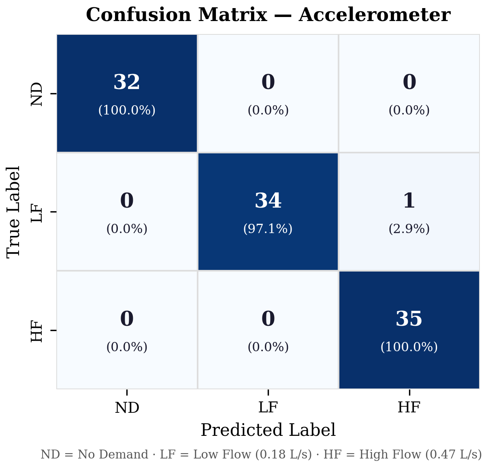
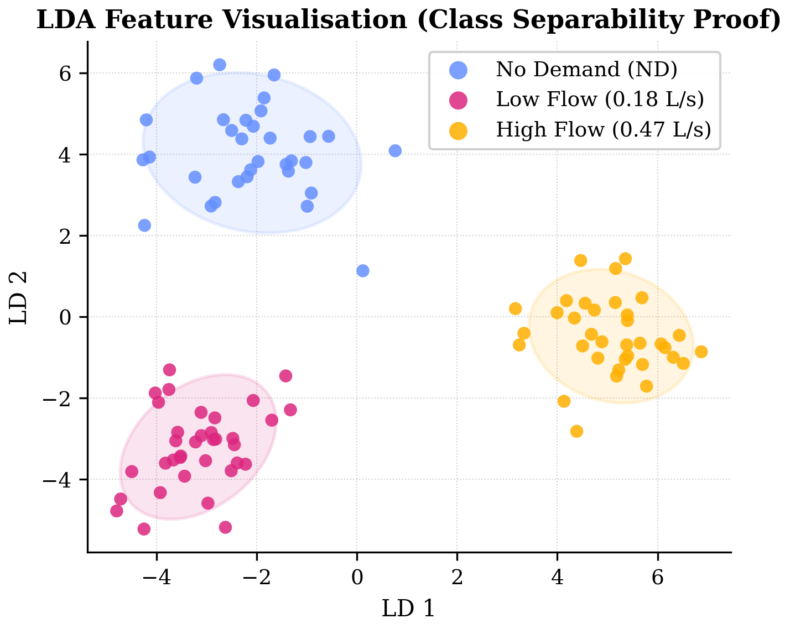
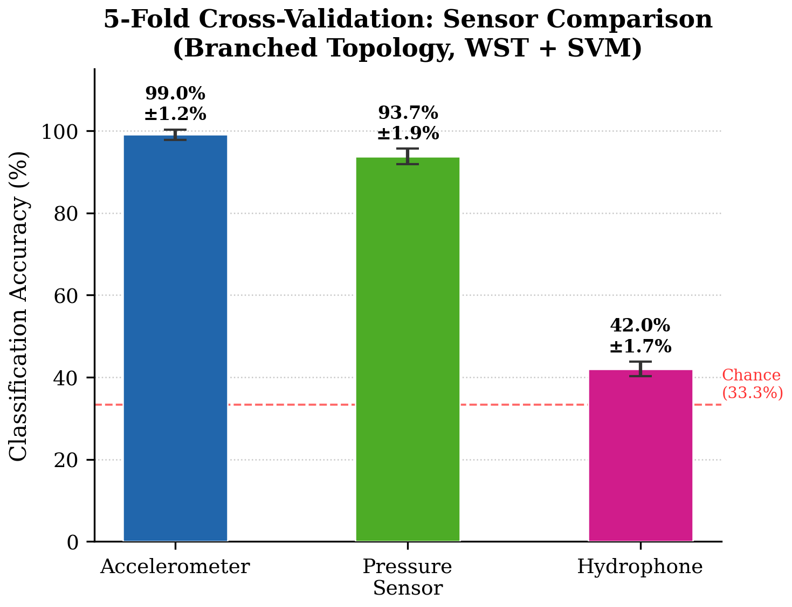
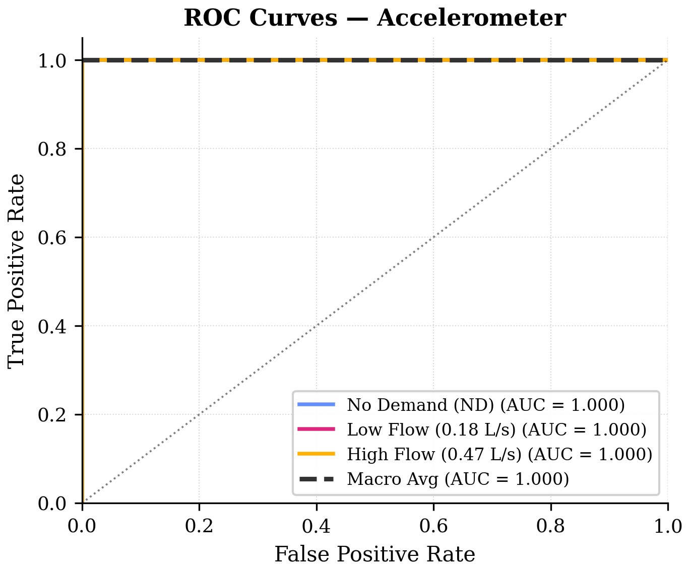
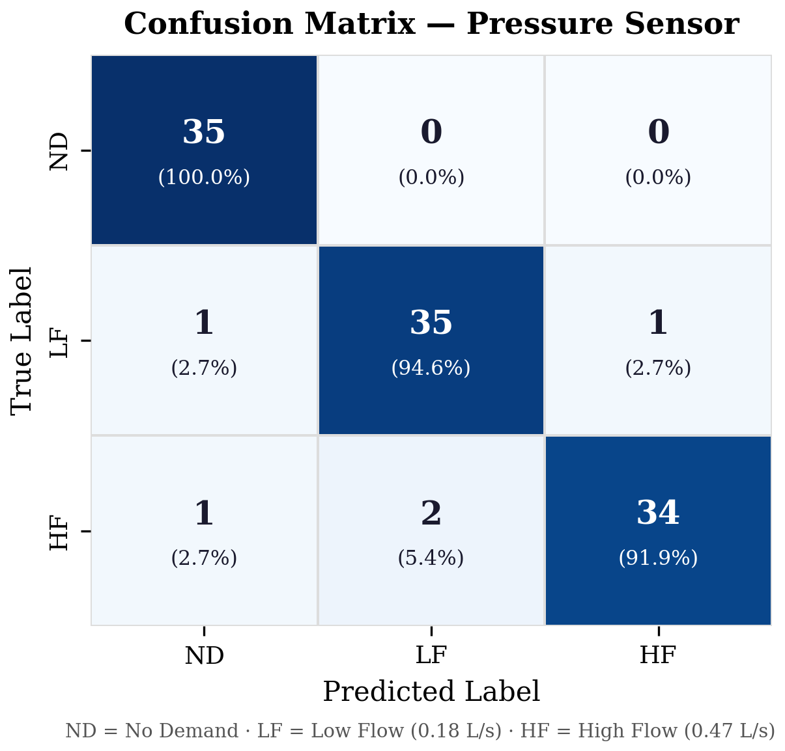
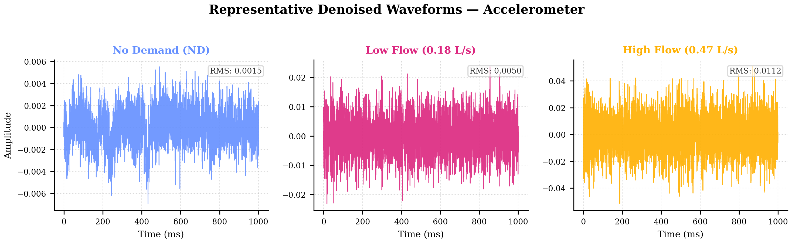
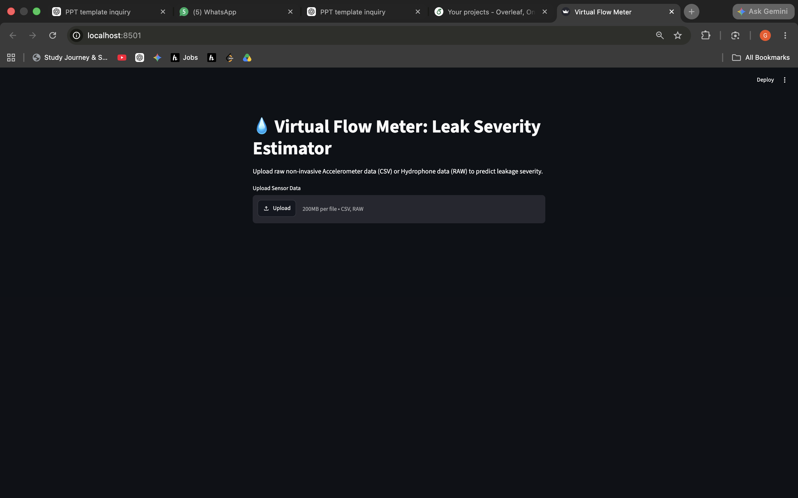
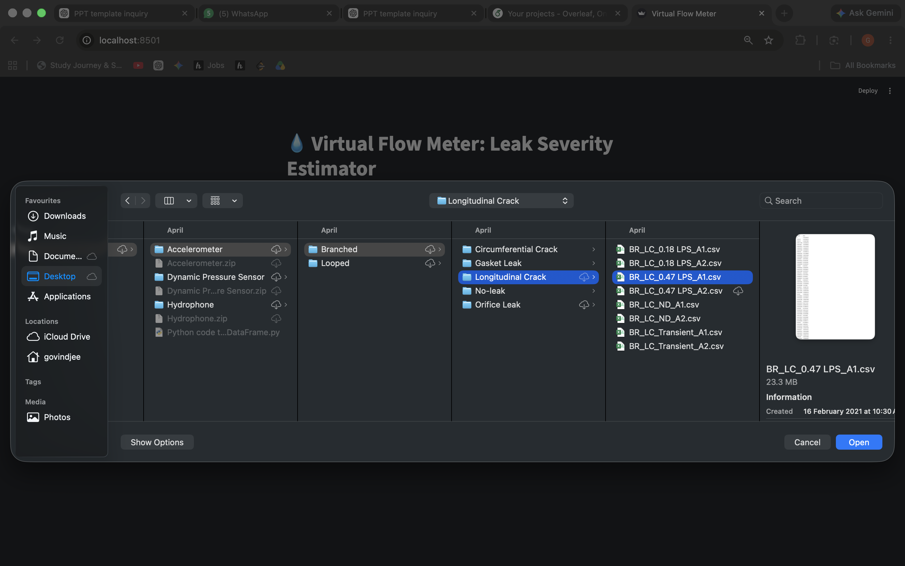
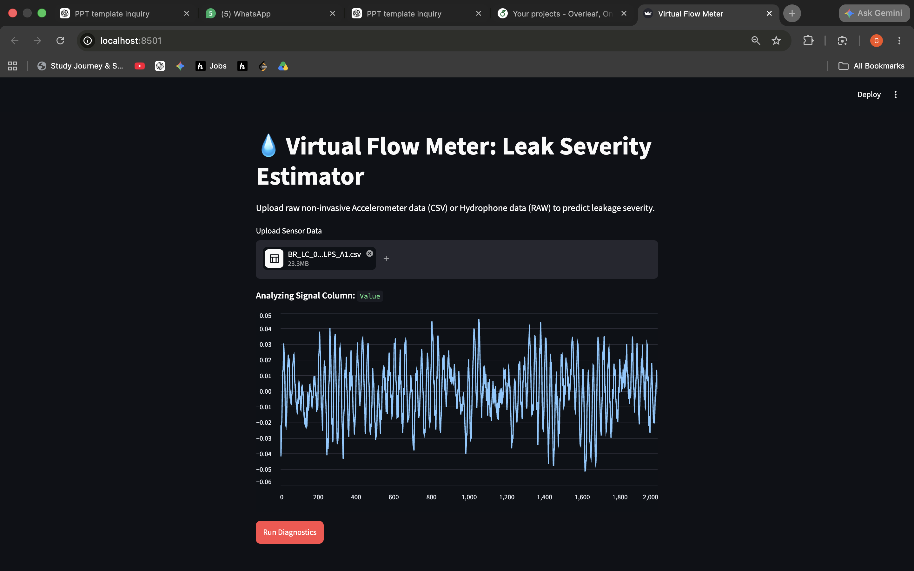
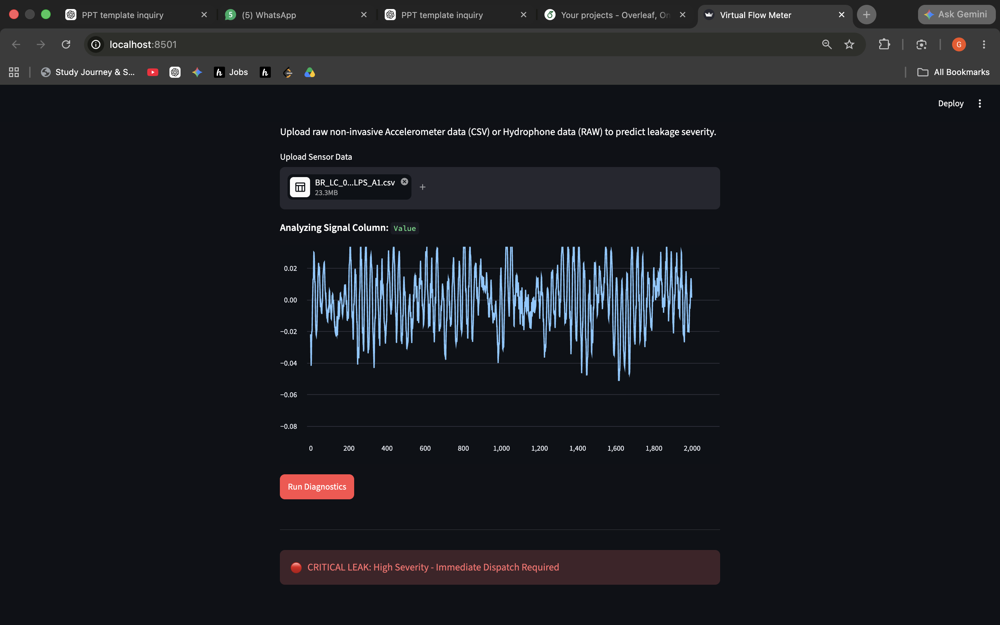

# Non-Invasive Water Leakage Severity Estimation System

[](paper/ICFCR2026_Paper105.pdf)
[](paper/ICFCR2026_Paper105.pdf)
[](presentation/ICFCR2026_Presentation.pdf)
[](https://www.python.org/)
[](app.py)
[](LICENSE)

Official open-source research implementation and diagnostic platform for ICFCR 2026 Paper 105:
> **"Non-Invasive Water Leakage Severity Estimation in Water Distribution Networks Using Wavelet Scattering Transform and Support Vector Machines"**  
> *Accepted at the International Conference on Frontier Communication and Research (ICFCR 2026).*

---

## 📌 Executive Summary

Non-Revenue Water (NRW) due to pipe bursts and undetected micro-leaks results in catastrophic global resource and revenue losses. While conventional acoustic monitoring can detect leak existence, **quantifying leak severity non-invasively** remains an elusive challenge due to non-stationary transient noise, environmental interference, and pipe boundary reflections.

This repository implements an end-to-end machine learning system that transforms high-frequency surface vibration signals into accurate, discrete leak severity classifications:
1. **Non-Invasive Sensing**: Operates via pipe surface-mounted accelerometers without drilling into pressurized mains or risking water contamination.
2. **Physics-Informed Feature Demodulation**: Employs a 2nd-order **Wavelet Scattering Transform (WST)** using Morlet wavelets to yield translation-invariant, deformation-stable multiscale vibrational representations.
3. **Rigorous Signal Conditioning**: Denoises transient turbulence using Symlet-3 (`sym3`) discrete wavelet transform with Donoho universal soft thresholding.
4. **Virtual Flow Meter UI**: Includes a ready-to-deploy **Streamlit** diagnostic web dashboard with pre-trained SVM model weights.

---

## 🔬 Benchmark & Scientific Findings

The methodology was evaluated on comprehensive laboratory testbed benchmarks across three distinct sensor modalities operating under identical hydraulic scenarios:
* **Accelerometer (Non-Invasive, Surface-Mounted)**: $f_s = 51,200\text{ Hz}$
* **Dynamic Pressure Transducer (Intrusive, Wetted)**: $f_s = 51,200\text{ Hz}$
* **Hydrophone (Invasive, Acoustic Submerged)**: $f_s = 8,000\text{ Hz}$

### Severity Classes Evaluated
* **Class 0 — No Demand (ND)**: Baseline intact pipe, $0.00\text{ L/s}$
* **Class 1 — Low Flow**: Minor orifice leak, $0.18\text{ L/s}$
* **Class 2 — High Flow**: Major burst orifice, $0.47\text{ L/s}$

### 5-Fold Stratified Cross-Validation Results

| Sensor Modality | Invasiveness | Sampling Rate ($f_s$) | CV Accuracy (Mean ± SD) | Macro F1-Score | Key Distinction |
| :--- | :---: | :---: | :---: | :---: | :--- |
| **Accelerometer** | **Non-Invasive** | **51,200 Hz** | **99.02% ± 1.24%** | **0.9905** | **Optimal**: Captures shell pipe-wall shear and flexural modes |
| **Dynamic Pressure** | Intrusive | 51,200 Hz | **93.71% ± 1.90%** | **0.9542** | High accuracy; exactly 5 misclassifications out of 109 test instances |
| **Hydrophone** | Invasive | 8,000 Hz | **42.00% ± 1.74%** | **0.4365** | Ineffective for severity estimation; acoustic reflections mask flow rates |

> **Scientific Disclosure on Cross-Validation & Generalization:**
> * Peak accuracy during exploratory hyperparameter grid search on accelerometer data reached **99.2%** ($C=100$, $\gamma=1.0$).
> * Forensic **Group Cross-Validation** (evaluating generalization across unseen physical pipe network topologies) yields **64.00% ± 20.95%** on Accelerometer, **56.01% ± 23.53%** on Dynamic Pressure, and **27.00% ± 5.95%** on Hydrophone. This confirms that structural vibration signatures encode boundary condition coupling, underscoring the necessity of topology-aware calibration in municipal deployments.

---

## 📊 Visualizations & Forensic Proofs

| Accelerometer Confusion Matrix | Supervised Class Separation (LDA) | Sensor Modality Benchmark |
| :---: | :---: | :---: |
|  |  |  |
| *99.02% Accuracy across 3 classes* | *Distinct clustering across leak regimes* | *Surface Accelerometer outperforms intrusive sensors* |

| ROC Curve (Multiclass) | Multi-Modal Confusion Matrices | Raw Signal Waveforms |
| :---: | :---: | :---: |
|  |  |  |
| *Macro-average AUC = 1.00* | *Pressure Sensor CM (93.71%)* | *Transient structural response per severity level* |

---

## 💻 Virtual Flow Meter Diagnostic Dashboard

The repository includes a web-based diagnostic application built with Streamlit (`app.py`), enabling operators to upload field sensor recordings and instantaneously obtain leak severity diagnostics.

| Dashboard Upload | Normal Operation (No Demand) |
| :---: | :---: |
|  |  |
| **Low Leak Detected (0.18 L/s)** | **Critical Leak Detected (0.47 L/s)** |
|  |  |

---

## 🛠️ Repository Architecture

```text
Water-Leakage-Severity-Estimation-System/
├── README.md                      # Comprehensive project documentation
├── requirements.txt               # Locked Python dependencies
├── LICENSE                        # MIT License
├── water_leak_classifier.py       # End-to-end scientific pipeline (DWT + WST + SVM)
├── app.py                         # Streamlit Virtual Flow Meter interactive application
├── train_and_export.py            # Model training, hyperparameter fit & export script
├── models/                        # Pre-trained production weights
│   ├── svm_accelerometer_model.joblib   # Trained RBF-SVM classifier
│   └── scaler.joblib                    # Fitted feature standardizer
├── paper/                         # Accepted peer-reviewed scientific paper
│   └── ICFCR2026_Paper105.pdf
├── presentation/                  # Conference slide deck
│   └── ICFCR2026_Presentation.pdf
├── assets/
│   ├── figures/                   # 16 High-resolution publication plots
│   │   ├── Fig_Accuracy_Comparison.png
│   │   ├── Fig_CM_Accelerometer.png
│   │   ├── Fig_CM_Dynamic_Pressure_Sensor.png
│   │   ├── Fig_CM_Hydrophone.png
│   │   ├── Fig_LDA_Accelerometer.png
│   │   ├── Fig_LDA_Dynamic_Pressure_Sensor.png
│   │   ├── Fig_LDA_Hydrophone.png
│   │   ├── Fig_ROC_Accelerometer.png
│   │   └── Fig_Waveforms_Accelerometer.png
│   └── screenshots/               # Streamlit application UI walkthrough
│       ├── ui_dashboard_landing.png
│       ├── ui_no_demand_normal.png
│       ├── ui_low_severity_leak.png
│       └── ui_high_severity_critical.png
└── docs/                          # Conference delivery script & guides
    └── conference_presentation_speech.md
```

---

## 🚀 Quick Start Guide

### 1. Installation
Clone the repository and install the dependencies in a virtual environment:
```bash
git clone https://github.com/Govind-Jee/Water-Leakage-Severity-Estimation-System.git
cd Water-Leakage-Severity-Estimation-System

# Create and activate Python virtual environment
python3 -m venv venv
source venv/bin/activate  # On Windows: venv\Scripts\activate

# Install required packages
pip install -r requirements.txt
```

### 2. Launch the Virtual Flow Meter (Web UI)
Launch the interactive diagnostic interface:
```bash
streamlit run app.py
```
Open your browser at `http://localhost:8501`, upload an accelerometer vibration CSV recording, and click **Run Diagnostics**.

### 3. Run the Scientific Classification Pipeline
To execute the complete preprocessing, multiscale feature extraction, and evaluation pipeline from scratch:
```bash
python3 water_leak_classifier.py
```

### 4. Train and Export Models
To retrain the model and export updated serialized `.joblib` weights:
```bash
python3 train_and_export.py
```

---

## ⚙️ Algorithmic Formulation

### 1. DWT Denoising (Symlet-3)
Signals are decomposed into 4 levels of detail coefficients using the `sym3` wavelet:
$$\hat{\sigma} = \frac{\text{median}(|d_1|)}{0.6745}, \quad \lambda = \hat{\sigma}\sqrt{2\ln N}$$
Soft thresholding is applied to remove high-frequency measurement noise while preserving structural shock transients.

### 2. Wavelet Scattering Transform (WST)
Features are computed using a cascade of Morlet wavelets $\psi_{\lambda}$ and modulus operators:
$$S_0 x(t) = x \ast \phi_J(t)$$
$$S_1 x(t, \lambda_1) = |x \ast \psi_{\lambda_1}| \ast \phi_J(t)$$
$$S_2 x(t, \lambda_1, \lambda_2) = ||x \ast \psi_{\lambda_1}| \ast \psi_{\lambda_2}| \ast \phi_J(t)$$
Invariance to spatial/temporal micro-shifts is guaranteed by the low-pass filter $\phi_J$. Second-order coefficients capture the modulation structure of leak-induced acoustic turbulence.

### 3. Support Vector Machine Classification
Features are standardized and classified using an RBF kernel:
$$K(x, x') = \exp(-\gamma \|x - x'\|^2)$$
Hyperparameters ($C=100, \gamma=1.0$) maximize the soft-margin separation in the demodulated scattering Hilbert space.

---

## 📑 Citation

If you find this research, code, or pre-trained models useful in your work, please cite the paper:

```bibtex
@inproceedings{govindjee2026waterleak,
  author    = {Govind Jee},
  title     = {Non-Invasive Water Leakage Severity Estimation in Water Distribution Networks Using Wavelet Scattering Transform and Support Vector Machines},
  booktitle = {Proceedings of the International Conference on Frontier Communication and Research (ICFCR 2026)},
  year      = {2026},
  note      = {Paper ID 105}
}
```

---

## 📜 License

This project is licensed under the MIT License — see the [LICENSE](LICENSE) file for details.
